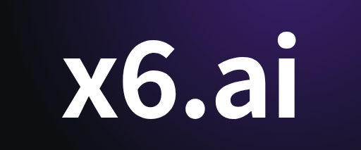

# Quotio

<p align="center">
  <picture>
    <source media="(prefers-color-scheme: light)" srcset="apps/macos/screenshots/menu_bar.png" />
    
  </picture>
</p>

<p align="center">
  
  
  
  <a href="apps/macos/README.md"></a>
  <a href="README.vi.md"></a>
  <a href="README.zh.md"></a>
</p>

<p align="center">
  <a href="https://trendshift.io/repositories/16304?utm_source=repository-badge&amp;utm_medium=badge&amp;utm_campaign=badge-repository-16304" target="_blank" rel="noopener noreferrer"></a>
  <a href="https://trendshift.io/repositories/16304?utm_source=trendshift-badge&amp;utm_medium=badge&amp;utm_campaign=badge-trendshift-16304" target="_blank" rel="noopener noreferrer"></a>
  <a href="https://trendshift.io/repositories/16304?utm_source=trendshift-badge&amp;utm_medium=badge&amp;utm_campaign=badge-trendshift-16304" target="_blank" rel="noopener noreferrer"></a>
  <a href="https://trendshift.io/repositories/16304?utm_source=trendshift-badge&amp;utm_medium=badge&amp;utm_campaign=badge-trendshift-16304" target="_blank" rel="noopener noreferrer"></a>
  <a href="https://trendshift.io/repositories/16304?utm_source=trendshift-badge&amp;utm_medium=badge&amp;utm_campaign=badge-trendshift-16304" target="_blank" rel="noopener noreferrer"></a>
  <a href="https://trendshift.io/repositories/16304?utm_source=trendshift-badge&amp;utm_medium=badge&amp;utm_campaign=badge-trendshift-16304" target="_blank" rel="noopener noreferrer"></a>
</p>

<p align="center">
  <strong>Le centre de commande ultime pour vos assistants de codage IA sur macOS.</strong>
</p>

Quotio est une application macOS native pour gérer **CLIProxyAPI** - un serveur proxy local qui alimente vos agents de codage IA. Il vous aide à gérer plusieurs comptes IA, suivre les quotas et configurer les outils CLI en un seul endroit.

## 🌟 Sponsors

### Featured Sponsor

<p align="center">
  <a href="https://pateway.ai/?ch=wmw7uy">
    
  </a>
</p>

Thanks to [PatewayAI](https://pateway.ai/?ch=wmw7uy) for sponsoring this project!
PatewayAI specializes in high-quality official model API relay services. It fully
supports Claude and GPT series, with transparent billing and enterprise-grade services.
Our Economy Mode offers discounts as low as 5% off!
[Sign up via this link](https://pateway.ai/?ch=wmw7uy) to receive trial credits. You
can also join occasional promotions to claim free credits. The two-way referral reward
is up to $150.

### Standard Sponsors

<table>
  <tr>
    <td width="180" align="center">
      <a href="https://www.swiftproxy.net/?ref=quotio">
        
      </a>
    </td>
    <td>
      Power your AI-powered workflows with
      <a href="https://www.swiftproxy.net/?ref=quotio">Swiftproxy</a>, a residential
      proxy provider offering rotating and static residential proxies for reliable web
      access and data collection. Access 90M+ residential IPs across 220+ locations,
      with HTTP(S), SOCKS5, and flexible rotating and sticky sessions. Try it for free
      and get started with residential proxies from just $0.7/GB. Use code
      <strong>PROXY90</strong> for an additional 10% off.
      <br />
      <a href="https://www.swiftproxy.net/?ref=quotio">Explore Swiftproxy →</a>
    </td>
  </tr>
  <tr>
    <td width="180" align="center">
      <a href="https://88api.ai/sign-up?aff=OMpN">
        
      </a>
    </td>
    <td>
      <a href="https://88api.ai/sign-up?aff=OMpN">88API</a> is a Hong Kong-operated
      multi-model AI API platform for developers, creators, and AI applications. It
      provides a unified API for text, image, audio, and video models, supporting common
      workflows such as AI coding, translation, content creation, voice generation, image
      generation, and video generation. 88API can be added and switched directly in CC
      Switch. It supports major international payment methods, can provide invoices, and
      offers stable service for teams and individual developers. Users who register
      through <a href="https://88api.ai/sign-up?aff=OMpN">this dedicated link</a> may
      receive complimentary credits.
      <br />
      <a href="https://88api.ai/sign-up?aff=OMpN">Explore 88API →</a>
    </td>
  </tr>
  <tr>
    <td width="180" align="center">
      <a href="https://proxy-seller.com/?partner=442060D973F44C90">
        
      </a>
    </td>
    <td>
      <a href="https://proxy-seller.com/?partner=442060D973F44C90">Proxy-Seller</a> gives you reliable proxy infrastructure for any
      workflow: private residential, mobile (4G/5G/LTE), ISP, and datacenter IPv4/IPv6
      proxies, all with HTTP(S) and SOCKS5 support. Tap into 47M+ residential IPs across
      220+ locations, target exactly the country, city, or ISP you need, and count on
      99.7% uptime backed by 24/7 support. Quotio users get 15% off with promo code
      <strong>QUOTIO</strong>.
      <br />
      <a href="https://proxy-seller.com/?partner=442060D973F44C90">Explore Proxy-Seller →</a>
    </td>
  </tr>
  <tr>
    <td width="180" align="center">
      <a href="https://x6.ai">
        
      </a>
    </td>
    <td>
      <a href="https://x6.ai">x6.ai</a>: One API key for every major model. Official-key and proxy
      channels, up to 90% off, free credits on sign-up. Pay with Alipay, Google Pay,
      Apple Pay, Visa or Mastercard.
      <br />
      <a href="https://x6.ai">Explore x6.ai →</a>
    </td>
  </tr>
</table>

Interested in sponsoring Quotio? Contact
[quotio@bytrong.app](mailto:quotio@bytrong.app).

## ✨ Fonctionnalités

- **🔌 Support Multi-Fournisseurs** : Connectez des comptes de Claude, OpenAI Codex, Qwen, Vertex AI, iFlow, Antigravity, Kiro, Trae et GitHub Copilot via OAuth ou clés API.
- **📊 Mode Quota Autonome** : Visualisez les quotas et les comptes sans exécuter le serveur proxy – idéal pour des vérifications rapides.
- **🚀 Configuration Agent en Un Clic** : Détection automatique et configuration des outils de codage IA comme Claude Code, OpenCode, et plus.
- **📈 Tableau de Bord en Temps Réel** : Surveillez le trafic des requêtes, l'utilisation des tokens et les taux de réussite en direct.
- **📉 Gestion Intelligente des Quotas** : Suivi visuel des quotas par compte avec stratégies de basculement automatique (Round Robin / Remplir d'abord).
- **🔑 Gestion des Clés API** : Générez et gérez les clés API pour votre proxy local.
- **🖥️ Intégration Barre de Menu** : Accès rapide à l'état du serveur, aperçu des quotas et icônes de fournisseurs personnalisés depuis votre barre de menu.
- **🔔 Notifications** : Alertes pour quotas faibles, périodes de refroidissement des comptes ou problèmes de service.
- **🔄 Mise à Jour Automatique** : Mise à jour Sparkle intégrée pour des mises à jour transparentes.
- **🌍 Multilingue** : Support anglais, vietnamien, chinois simplifié et français.

## 🤖 Écosystème Supporté

### Fournisseurs IA
| Fournisseur | Méthode d'Authentification |
|-------------|---------------------------|
| Anthropic Claude | OAuth |
| OpenAI Codex | OAuth |
| Qwen Code | OAuth |
| Vertex AI | JSON de compte de service |
| iFlow | OAuth |
| Antigravity | OAuth |
| Kiro | OAuth |
| GitHub Copilot | OAuth (GitHub.com ou hôte GHE.com à résidence des données en mode Surveillance) |

### Suivi de Quota IDE (Surveillance uniquement)
| IDE | Description |
|-----|-------------|
| Cursor | Détecté automatiquement lorsqu'installé et connecté |
| Trae | Détecté automatiquement lorsqu'installé et connecté |

> **Note** : Ces IDE sont uniquement utilisés pour la surveillance de l'utilisation des quotas. Ils ne peuvent pas être utilisés comme fournisseurs pour le proxy.

### Agents CLI Compatibles
Quotio peut configurer automatiquement ces outils pour utiliser votre proxy centralisé :
- Claude Code
- Codex CLI
- Amp CLI
- OpenCode
- Factory Droid

## 🚀 Installation

### Prérequis
- macOS 14.0 (Sonoma) ou ultérieur
- Connexion Internet pour l'authentification OAuth

### Homebrew (Recommandé)
```bash
brew tap nguyenphutrong/tap
brew install --cask quotio
```

### Téléchargement
Téléchargez le dernier `.dmg` depuis la page [Releases](https://github.com/nguyenphutrong/quotio/releases).

Les versions officielles sont signées avec Developer ID et notariées par Apple ; aucun contournement de Gatekeeper n'est nécessaire.

### Compilation depuis les Sources

1. **Clonez le dépôt :**
   ```bash
   git clone https://github.com/nguyenphutrong/quotio.git
   cd quotio/apps/macos
   ```

2. **Ouvrez dans Xcode :**
   ```bash
   open Quotio.xcodeproj
   ```

3. **Compilez et Exécutez :**
   - Sélectionnez le schéma "Quotio"
   - Appuyez sur `Cmd + R` pour compiler et exécuter

> L'application téléchargera automatiquement le binaire `CLIProxyAPI` au premier lancement.

## 📖 Utilisation

### 1. Démarrer le Serveur
Lancez Quotio et cliquez sur **Démarrer** dans le tableau de bord pour initialiser le serveur proxy local.

### 2. Connecter des Comptes
Allez dans l'onglet **Fournisseurs** → Cliquez sur un fournisseur → Authentifiez-vous via OAuth ou importez des identifiants.

### 3. Configurer les Agents
Allez dans l'onglet **Agents** → Sélectionnez un agent installé → Cliquez sur **Configurer** → Choisissez le mode Automatique ou Manuel.

### 4. Surveiller l'Utilisation
- **Tableau de bord** : Santé générale et trafic
- **Quota** : Détail de l'utilisation par compte
- **Logs** : Logs bruts requête/réponse pour le débogage

## ⚙️ Paramètres

- **Port** : Modifier le port d'écoute du proxy
- **Stratégie de Routage** : Round Robin ou Remplir d'abord
- **Démarrage Automatique** : Lancer le proxy automatiquement à l'ouverture de Quotio
- **Notifications** : Activer/désactiver les alertes pour divers événements

## 📸 Captures d'Écran

### Tableau de Bord
<picture>
  <source media="(prefers-color-scheme: dark)" srcset="apps/macos/screenshots/dashboard_dark.png" />
  <source media="(prefers-color-scheme: light)" srcset="apps/macos/screenshots/dashboard.png" />
  
</picture>

### Fournisseurs
<picture>
  <source media="(prefers-color-scheme: dark)" srcset="apps/macos/screenshots/provider_dark.png" />
  <source media="(prefers-color-scheme: light)" srcset="apps/macos/screenshots/provider.png" />
  
</picture>

### Configuration des Agents
<picture>
  <source media="(prefers-color-scheme: dark)" srcset="apps/macos/screenshots/agent_setup_dark.png" />
  <source media="(prefers-color-scheme: light)" srcset="apps/macos/screenshots/agent_setup.png" />
  
</picture>

### Surveillance des Quotas
<picture>
  <source media="(prefers-color-scheme: dark)" srcset="apps/macos/screenshots/quota_dark.png" />
  <source media="(prefers-color-scheme: light)" srcset="apps/macos/screenshots/quota.png" />
  
</picture>

### Clés API
<picture>
  <source media="(prefers-color-scheme: dark)" srcset="apps/macos/screenshots/api_keys_dark.png" />
  <source media="(prefers-color-scheme: light)" srcset="apps/macos/screenshots/api_keys.png" />
  
</picture>

### Paramètres
<picture>
  <source media="(prefers-color-scheme: dark)" srcset="apps/macos/screenshots/settings_dark.png" />
  <source media="(prefers-color-scheme: light)" srcset="apps/macos/screenshots/settings.png" />
  
</picture>

### Barre de Menu
<picture>
  <source media="(prefers-color-scheme: light)" srcset="apps/macos/screenshots/menu_bar.png" />
  
</picture>

## 🤝 Contribuer

1. Forkez le Projet
2. Créez votre Branche de Fonctionnalité (`git checkout -b feature/fonctionnalite-geniale`)
3. Commitez vos Modifications (`git commit -m 'Ajout d'une fonctionnalité géniale'`)
4. Poussez vers la Branche (`git push origin feature/fonctionnalite-geniale`)
5. Ouvrez une Pull Request

## 💖 Contributeurs

Nous n'aurions pas pu y arriver sans vous. Merci ! 🙏

<a href="https://github.com/nguyenphutrong/quotio/graphs/contributors">
  
</a>

## 📄 Licence

Licence MIT. Voir `LICENSE` pour plus de détails.
